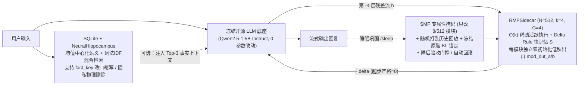

# RMP (Routed Module Pool) — 消费级显卡上的持续学习神经网络与 LLM 外挂

[中文](README.md) | **[English](README_EN.md)**

> **目标**：让一台只有 **8GB 显存（RTX 5060 Laptop）** 的本地电脑，跑起一个**越用越懂你、持续写入 30 天不遗忘通用能力、且支持改口与隐私彻底删除**的持续学习 AI 系统。

本项目完整记录了从 0 到 1 的 **109 轮真实实验（E01–E109）**：从最初的字节级动态稀疏可塑性网络（DSPN），演化出 **RMP（路由模块池，Routed Module Pool）**，最终验证并落地为 **「冻结开源 LLM + `O(k)` 稀疏 RMP 神经旁路 + SQLite 可删改海马体」** 架构与零依赖本地流式网页聊天控制台。

---

## 一、前因后果与来龙去脉

现代大语言模型（LLM）出厂即定型：关掉窗口，它就退回出厂那天的新手。市面上常见两种补救方案，但各有死穴：

1. **纯 RAG（外挂向量库）**：模型权重一个字没改，只是每次提问现查小抄贴进提示词。适合记零碎事实，但无法把长期规则、专有暗号、行为习惯内化进模型直觉。
2. **普通微调 / LoRA**：所有新旧知识挤在同一块共享权重里，连续微调几轮就会触发**灾难性遗忘**（学了新规矩，写代码、做数学、说人话开始退化）或**后学覆前学**。

我们沿着一条完整、可证伪的实验路线走了 109 轮：

- **阶段 1（E01–E71，DSPN 字节级原型）**：在固定内存预算下探索门控线性循环 `c` + 快记忆矩阵 `S`（Gated Delta Rule）+ 局部 MLP + 全局记忆中枢，验证固定内存长程记忆与类脑局部学习（含 `e-prop` 实测与证伪）。
- **阶段 2（E72–E105，RMP 路由模块池）**：把单一网络拆成多波稀疏路由的模块池（`WavePool`），引入多尺度语境路由（`wave_ctx`）、**SMF 专属性掩码（Specificity-Masked Fine-tuning）**、严格屏蔽未选模块优化器状态的 `_masked_step`，以及带验收回滚的睡眠巩固（`sleep`）。
- **阶段 3（E106–E108，留一源遗忘门控与共享专家消融）**：在 3 源混训留 1 源（OOD 对话）的严格基准上，发现 **`shared=1`（冻结通用底座）+ 稀疏路由专有模块** 同时带来 `-0.141 bpc`、更强分工（`src_sel=0.503`）、`4.4×` 新词学习速度与 `2–3×` 更低遗忘——直接指明了**“冻结成熟开源 LLM 做共享通用底座 + 挂接大池稀疏 RMP 做持续学习旁路”**的终极路线。
- **阶段 4（E109，冻结 LLM + `N=512` `O(k)` 稀疏 RMP 旁路 + SQLite 海马体）**：在单张 8GB 显卡上挂载 `Qwen2.5-1.5B-Instruct` + `512` 模块稀疏 RMP（每模块独立零初始化低秩出口），完成 **30 天 100 条零 RAG 规则 + 900 条干扰闲聊 + 3 跳改口 + 隐私彻底删除** 暴力压测，并封装成可日常使用的本地流式网页控制台。

---

## 二、设计哲学

1. **承认分工，不迷信单一万能模块（双层互补）**
   - 人脑也没有只靠新皮层权重死记硬背一切，而是 **海马体（快速情景记忆） + 新皮层（慢速结构内化）** 协同工作。
   - **SQLite + 神经海马体** 负责个人零碎事实（住哪、猫叫什么、今天改口、隐私一键物理抹除）——要求 **1 秒记住、1 秒改口、聊任何话题都能被自然想起、删完 100% 不留痕**。
   - **RMP 旁路** 负责把确认后的规则、偏好、领域习惯沉淀进神经网络权重，且在不靠任何提示词小抄的情况下也能直接触发。
2. **务实对待反向传播：瓶颈不在链式法则，而在「参数踩踏」**
   - 我们在早期实验中实测过纯无反传局部学习（`e-prop`），在复杂语言任务上精度明显落后。
   - 真正导致 AI 无法持续学习的瓶颈不是反向传播本身，而是**所有知识挤在同一块权重里互相踩踏**。因此我们采用：**反向传播算精确梯度 + 512 个独立出口路由隔离 + SMF 专属性硬掩码（每次只改 1.5% 对口且最不伤老业务的模块）+ 冻结原脑 KL 锚定 + 睡后体检验收与自动回滚**。
3. **醒时防污染，睡时可回滚**
   - 平时聊天不直接改权重，防止闲聊废话和模型幻觉污染参数；通过代码级原文核验与去重门控筛出可靠规则，进入睡眠队列，睡后通用能力波动超红线自动整步回滚。

---

## 三、核心架构与原理



### 关键技术创新

1. **SMF 专属性掩码（不瞎改冷门模块，只改“既对口又少碰老业务”的模块）**：
   $$\text{Score}_i = \frac{\text{Freq}_{\text{new}}(i)}{\text{Freq}_{\text{bg}}(i) + \varepsilon}$$
   先跑一遍待巩固新规则统计激活频率 $\text{Freq}_{\text{new}}(i)$（未激活的得分为 0，绝不选中），再除以通用中英文/代码/数学语料的背景占用频率 $\text{Freq}_{\text{bg}}(i)$，仅放开 Top-$k$（如 `8 / 512 ≈ 1.5%`）模块的参数与 Adam 动量更新（`_masked_step`），其余 `504` 个模块逐比特冻结。
2. **每模块独立零初始化低秩出口（`mod_out_a / mod_out_b`）**：
   取消传统共享输出层 `proj_out`，改为每模块独立低秩投影且 `mod_out_b` 全零初始化——挂载瞬间输出与原版 LLM **逐位一致（`atol=1e-6`）**，且彻底消除“改模块 A 拖累模块 B”的共享出口漂移。
3. **`O(k)` 稀疏活跃执行 + `T=1` 单拍快路径**：
   只对每波实际被路由到的活跃模块执行 `forward_slice` 与低秩出口计算，显存与算力与总模块数 $N$ 解耦，使 `N=512` 可在 8GB 显卡稳跑；自回归解码（`T=1`）走零 CPU-GPU 同步 `topk` 与单拍解析快路径，推理速度从 `3.2 tok/s` 提升至 **`10.9 tok/s`（3.4×）**。

---

## 四、核心实验数据（全部附原始 JSON 记录）

### 1. 留一源防遗忘与共享专家消融（E106–E108，字节级 `task3`，`N=48, G=4`）

| 实验 | 架构与策略 | 预训练 bpc | 模块分工 `src_sel` | 新领域学习收益 | 最差旧源上升（越低越好） | 结论 |
|---|---|---:|---:|---:|---:|---|
| E106 | 纯路由 `k=4`，无 SMF（基线） | 1.9240 | 0.453 | `chat_drop=0.38` | `+0.128` | 不屏蔽老业务高频模块，遗忘显著 |
| E107 | 纯路由 `k=4` + `SMF-8` + 睡眠 | 1.9240 | 0.453 | `chat_drop=0.381` | **`+0.047`** | SMF 使最差旧源遗忘直降 **2.7×**（`14/14` 睡眠提交） |
| **E108** | **`shared=1`（冻结）+ 路由 `k=3` + `SMF-8`** | **`1.7826` (-0.141)** | **`0.503`** | **`chat_drop=0.349` / `0.527`** | **`+0.040`（未睡）/ 故事 `+0.039`** | 同激活算力全面大胜，直接验证“冻结通用底座 + 稀疏专有模块” |

### 2. 30 天高强度暴力压测（E109，`Qwen2.5-1.5B-Instruct` + `N=512` 稀疏 RMP + SQLite，RTX 5060 Laptop 8GB）

测试条件：连续 30 天，10 批 × 10 = **100 条新规则（测试时 0 RAG 提示词，纯考 RMP 权重）** + 900 条干扰闲聊 + 10 次改口（含 3 跳城市改口 `Melbourne → Sydney → Brisbane → Perth`）+ Day 15 隐私删除。

| 时间节点 | 已巩固规则 | 第 1 批旧规则留存（纯权重） | 最新批掌握（纯权重） | 英文 Δ | 中文 Δ | 代码 Δ | 数学 Δ | 峰值显存 | 数据库体积 |
|---|---:|---:|---:|---:|---:|---:|---:|---:|---:|
| Day 3 | 10 条 | 3/10 | 3/10 | `+0.0172` | `+0.0005` | `0.0000` | `-0.0004` | 4,920 MB | 4 KB |
| Day 10 | 30 条 | 8/10 | 6/10 | `+0.0347` | `-0.0051` | `+0.0006` | `-0.0004` | 5,059 MB | 4 KB |
| Day 20 | 60 条 | 1/10* | 4/10 | `+0.0976` | `-0.0001` | `-0.0011` | `-0.0004` | 5,078 MB | 88 KB |
| **Day 30** | **100 条** | **7/10** | **9/10** | **`+0.0195`** | **`+0.0002`** | **`+0.0035`** | **`-0.0044`** | **5,078 MB** | **152 KB** |

> \* **压测真实发现与已修复 Bug**：Day 20 的阶段性回撤暴露了固定取模回放抽样不均问题（已改为每轮睡眠随机打乱 `confirmed_qa`）；Day 30 海马体 `7/9` 暴露了无键闲聊误覆盖带 `fact_key` 槽位问题（已加 `fact_key` 保护锁并补入回归单测）。3 跳城市改口（`Perth`）旧值 0 泄露，Day 15 隐私删除 `True`。

原始实验 JSON 全部保留在 [runs/](runs) 目录，完整实验台账见 [docs/experiments/README.md](docs/experiments/README.md)。

---

## 五、坦诚的局限性（我们不会隐瞒的事）

1. **纯权重记忆的自由聊天泛化天然弱于上下文**：只靠单句 QA 睡进 RMP 权重，本质接近条件反射式映射；如果想在随便聊天时也能自然想起“你喜欢喝无糖可乐 / 住珀斯”，仍需开启海马体/SQLite 配合——这也是我们坚持双层架构的原因。
2. **小模型自动抽取器存在幻觉风险**：用 `1.5B` 做自动记忆抽取时可能把问句臆测成事实，因此我们在工程上强制加了**无问号问句拦截 + 答案关键词原文核验**两道硬防线。
3. **权重无法一键物理抹除**：隐私彻底删除与 1 秒改口由 SQLite/海马体承担，RMP 权重中的旧映射需要靠新数据睡眠覆盖或随旧底座退役。

---

## 六、快速开始

### 环境要求
- Python 3.10+、PyTorch（CUDA 推荐，8GB 显存即可稳跑 `large` 档 `Qwen2.5-1.5B + N=512`）
- `transformers`、`accelerate`、`safetensors`（网页端零额外依赖，无需安装 Gradio/FastAPI）

### 1. 启动本地流式网页聊天控制台（推荐）
```bash
python tools/web_chat_sidecar.py --preset large --port 7860
```
浏览器打开 `http://127.0.0.1:7860`。界面支持实时独立开关 **「海马体/SQLite 检索」**、**「RMP 旁路权重」**、**「自动抽取记忆」**，可直接对比纯原版模型 / 纯 RMP 权重 / 双层记忆效果。

### 2. 命令行交互对话
```bash
python tools/chat_llm_sidecar.py --preset large
# 支持命令：/list  /edit <id> <内容>  /del <id>  /fact 键=内容  /teach 问题 => 答案  /sleep  /new  /stats
```

### 3. 运行单元测试与 30 天压测
```bash
# 运行核心单元测试（侧挂模块等价性、零初始化、SMF 掩码、SQLite CRUD、fact_key 保护等）
DSPN_FLA=0 pytest tests/test_sidecar.py tests/test_pool.py tests/test_online.py -q

# 复现 30 天高强度压测（约 15 分钟，RTX 5060 8GB）
python tools/test_30day_stress.py --preset large
```

---

## 七、仓库结构与完整文档索引

| 目录 / 文件 | 说明 |
|---|---|
| [llm_sidecar.py](llm_sidecar.py) | 冻结 LLM 挂载器、`RMPSidecar`（独立低秩出口 + `O(k)` 稀疏执行）、`NeuralHippocampus`、`SidecarLearner` |
| [pool.py](pool.py) | `WavePool` 多波路由模块池、多尺度语境路由 `wave_ctx`、共享专家 `shared`、竞争地址学习 |
| [dspn_text.py](dspn_text.py) | 底层循环核 `Layer`（门控线性循环 `c` + Gated Delta Rule 快记忆 `S` + `T=1` 单拍快路径） |
| [online.py](online.py) | SMF 专属性掩码、`_masked_step`（零动量漂移）、带验收回滚的睡眠巩固 |
| [memory_store.py](memory_store.py) | 与具体 LLM 解耦的 SQLite WAL 长期记忆库（换模型自动重建海马体索引） |
| [tools/web_chat_sidecar.py](tools/web_chat_sidecar.py) | 零依赖本地流式网页聊天 + 记忆控制台 + 防幻觉自动抽取门控 |
| [tools/test_30day_stress.py](tools/test_30day_stress.py) | 30 天 100 规则 + 900 干扰 + 3 跳改口 + 隐私删除压测脚本 |
| [docs/README.md](docs/README.md) | 完整文档总入口（设计哲学、文献调研、阶段规划、E01–E109 全部实验记录） |
| [docs/experiments/README.md](docs/experiments/README.md) | E01–E109 实验总表与原始 JSON 索引 |
| [tests/](tests) | 全套回归与等价性单元测试 |
