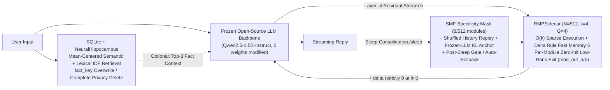

# RMP (Routed Module Pool) — Continual Learning Neural Sidecar & LLM Memory System on a Consumer 8GB GPU

[中文](README.md) | **[English](README_EN.md)**

> **Goal**: Run a practical continual-learning AI system on a single **8GB consumer GPU (RTX 5060 Laptop)** that learns continuously over 30+ days without catastrophic forgetting of general capabilities, while supporting instant overwrites and complete privacy deletion.

This repository documents **109 reproducible experiments (E01–E109)** from scratch: evolving from a byte-level Dynamic Sparse Plasticity Network (DSPN) into **RMP (Routed Module Pool)**, and finally into a **Frozen Open-Source LLM + `O(k)` Sparse RMP Neural Sidecar + SQLite Editable Hippocampus** architecture with a zero-dependency streaming local Web UI.

---

## 1. Origin & Evolution

Standard LLMs are frozen after pretraining: close the chat window and they reset to day one. The two common workarounds each hit a wall:

1. **Pure RAG (External Retrieval)**: Leaves model weights untouched and injects retrieved snippets into the prompt. Great for editable facts, but cannot internalize domain distributions, coding styles, behavioral habits, or long-term rules into model weights.
2. **Standard Fine-Tuning / LoRA**: Packs all old and new knowledge into the same shared weights. After several sequential update rounds, it suffers from **catastrophic forgetting** (general coding/math/language degrades) or **new-overwrites-old**.

Our 109-experiment trajectory:

- **Phase 1 (E01–E71, DSPN Byte-Level Prototype)**: Explored gated diagonal linear recurrence `c` + fast-weight matrix `S` (Gated Delta Rule) + local MLPs + global memory hub under a fixed memory budget, including falsifying pure backprop-free local learning (`e-prop`) on language modeling.
- **Phase 2 (E72–E105, RMP WavePool)**: Split the network into multi-wave sparsely routed module pools (`WavePool`) with multi-scale contextual routing (`wave_ctx`), **SMF (Specificity-Masked Fine-tuning)**, strict optimizer-state masking (`_masked_step`), and sleep consolidation with validation rollback.
- **Phase 3 (E106–E108, Leave-One-Source-Out Forgetting Gate & Shared-Expert Ablation)**: On a strict 3-source pretrain + unseen OOD-chat online learning benchmark, **`shared=1` (frozen general backbone) + sparsely routed specialist modules** simultaneously delivered `-0.141 bpc`, stronger specialization (`src_sel=0.503`), `4.4×` faster novel-word learning, and `2–3×` lower forgetting — directly motivating attaching a large sparse RMP sidecar onto a frozen open-source LLM.
- **Phase 4 (E109, Frozen LLM + `N=512` `O(k)` Sparse RMP Sidecar + SQLite Hippocampus)**: Attached `N=512` sparse RMP modules (with per-module zero-initialized low-rank exits) to a frozen `Qwen2.5-1.5B-Instruct` on 8GB VRAM, passed a **30-day heavy stress test** (100 zero-RAG rules + 900 distractors + 3-hop city overwrite + privacy deletion), and shipped a zero-dependency local streaming Web UI.

---

## 2. Design Philosophy

1. **Dual-Layer Complementary Memory (Not "One Hammer for Everything")**
   - Just like the human brain separates **hippocampus** (fast episodic facts) from **neocortex** (slow structural internalization):
   - **SQLite + Neural Hippocampus** handles personal episodic facts (where you live, pet names, instant corrections, 100% physical privacy deletion) — available naturally in free-form conversation with zero retraining latency.
   - **RMP Sidecar** handles weight-level continual learning: internalizing domain distributions, behavioral habits, formats, and confirmed rules into isolated neural modules without touching the frozen LLM backbone.
2. **Pragmatic About Backprop: The Real Bottleneck Is Parameter Interference**
   - Backpropagation is just the chain rule for computing gradients. The real blocker to continual learning is **shared weights trampling each other**.
   - We combine exact gradients with **512-module independent-exit routing isolation + SMF specificity masking (updating only `8/512 ≈ 1.5%` task-relevant, low-background-usage modules) + frozen-backbone KL anchoring + post-sleep validation & automatic rollback**.
3. **Safe Awake, Verifiable Asleep**
   - Regular chatting never directly mutates weights (preventing noise/hallucination poisoning). Candidate rules pass anti-hallucination grounding & deduplication checks before entering the sleep queue, and any sleep that degrades general capability beyond tolerance is automatically rolled back.

---

## 3. Architecture & Core Mechanisms



### Key Technical Pieces

1. **SMF Specificity Masking** (not random cold modules — modules that are **both** activated by the new task **and** least used by general background knowledge):
   $$\text{Score}_i = \frac{\text{Freq}_{\text{new}}(i)}{\text{Freq}_{\text{bg}}(i) + \varepsilon}$$
   Only the top-$k$ (`8/512 ≈ 1.5%`) modules receive parameter & Adam state updates via `_masked_step`; the remaining `504` modules stay bit-for-bit frozen.
2. **Per-Module Independent Zero-Init Low-Rank Exits (`mod_out_a / mod_out_b`)**:
   Replaces shared output projections with per-module low-rank exits initialized to zero — exact bitwise identity with the frozen LLM at initialization (`atol=1e-6`), eliminating cross-module exit drift.
3. **`O(k)` Sparse Execution + `T=1` Single-Step Fast Path**:
   Computes only the `k` active modules per wave (memory and FLOPs independent of total `N`), enabling `N=512` on 8GB VRAM; autoregressive decoding (`T=1`) eliminates GPU-CPU `.nonzero()`/`.any()` syncs and cuSOLVER dispatch, speeding up generation **3.4×** (`3.2 → 10.9 tok/s`).

---

## 4. Experimental Results (All Raw JSONs Included in `runs/`)

### 1. Leave-One-Source-Out Forgetting Gate & Shared-Expert Ablation (E106–E108, Byte-Level `task3`, `N=48, G=4`)

| Exp | Architecture & Policy | Pretrain bpc | Specialization `src_sel` | New-Domain Gain | Worst Old-Source Rise (lower = better) | Takeaway |
|---|---|---:|---:|---:|---:|---|
| E106 | Pure routed `k=4`, no SMF (baseline) | 1.9240 | 0.453 | `chat_drop=0.38` | `+0.128` | Updating high-background modules causes severe forgetting |
| E107 | Pure routed `k=4` + `SMF-8` + Sleep | 1.9240 | 0.453 | `chat_drop=0.381` | **`+0.047`** | SMF cuts worst-case forgetting **2.7×** (`14/14` sleeps committed) |
| **E108** | **`shared=1` (frozen) + routed `k=3` + `SMF-8`** | **`1.7826` (-0.141)** | **`0.503`** | **`chat_drop=0.349` / `0.527`** | **`+0.040` (pre-sleep) / Stories `+0.039`** | Strictly better at matched active compute; validates frozen backbone + sparse specialist pool |

### 2. 30-Day Heavy Stress Test (E109, `Qwen2.5-1.5B-Instruct` + `N=512` Sparse RMP + SQLite, RTX 5060 Laptop 8GB)

Protocol: 30 simulated days, 10 batches × 10 = **100 new rules (evaluated with ZERO RAG/prompt injection — pure RMP weights)** + 900 distractor statements + 10 overwrites (including 3-hop city overwrite `Melbourne → Sydney → Brisbane → Perth`) + Day 15 privacy deletion.

| Day | Consolidated Rules | Batch-1 Retention (Pure Weights) | Latest Batch (Pure Weights) | EN Δ | ZH Δ | Code Δ | Math Δ | Peak VRAM | SQLite DB |
|---|---:|---:|---:|---:|---:|---:|---:|---:|---:|
| Day 3 | 10 | 3/10 | 3/10 | `+0.0172` | `+0.0005` | `0.0000` | `-0.0004` | 4,920 MB | 4 KB |
| Day 10 | 30 | 8/10 | 6/10 | `+0.0347` | `-0.0051` | `+0.0006` | `-0.0004` | 5,059 MB | 4 KB |
| Day 20 | 60 | 1/10* | 4/10 | `+0.0976` | `-0.0001` | `-0.0011` | `-0.0004` | 5,078 MB | 88 KB |
| **Day 30** | **100** | **7/10** | **9/10** | **`+0.0195`** | **`+0.0002`** | **`+0.0035`** | **`-0.0044`** | **5,078 MB** | **152 KB** |

> \* **Real bugs caught & fixed from this stress test**: The Day 20 dip exposed cyclic modulo sampling of `confirmed_qa` during sleep (fixed via per-sleep random shuffling); Day 30 hippocampus `7/9` exposed unkeyed distractors superseding `fact_key` slots (fixed via `fact_key` protection + regression unit test). 3-hop city overwrite (`Perth`) had 0 old-value leakage, and Day 15 privacy deletion passed (`True`).

---

## 5. Honest Limitations

1. **Single-sentence facts in pure weights are rigid**: Consolidating a single QA pair into neural weights behaves more like a narrow stimulus-response mapping than flexible free-chat reasoning. For everyday episodic facts ("what I like to drink", "where I live"), keeping the Hippocampus/SQLite layer enabled is essential; RMP shines on **domain distributions, styles/habits, and repeated structural rules** where RAG falls short.
2. **Small-model auto-extractors can hallucinate**: A 1.5B extractor can fabricate facts from questions without question marks; we mitigate this with deterministic question-cue filtering and source-text grounding verification.
3. **No instant physical "delete" inside neural weights**: Instant corrections and guaranteed privacy erasure belong to the SQLite/Hippocampus layer; weight-level changes require sleep consolidation or overwriting.

---

## 6. Quick Start

### Requirements
- Python 3.10+, PyTorch (CUDA recommended; 8GB VRAM runs the `large` preset `Qwen2.5-1.5B + N=512`)
- `transformers`, `accelerate`, `safetensors` (the Web UI uses Python's built-in `http.server`, zero extra web dependencies)

### Launch Local Streaming Web Chat UI
```bash
python tools/web_chat_sidecar.py --preset large --port 7860
```
Open `http://127.0.0.1:7860`. Use the live header switches (**Hippocampus/SQLite**, **RMP Sidecar**, **Auto Memory Gate**) to directly compare base LLM vs. pure RMP weights vs. dual-layer memory.

### CLI Chat & Tests
```bash
# Interactive CLI chat
python tools/chat_llm_sidecar.py --preset large

# Unit tests (identity at init, sparse=dense equivalence, SMF masking, SQLite CRUD, fact_key protection)
DSPN_FLA=0 pytest tests/test_sidecar.py tests/test_pool.py tests/test_online.py -q

# Reproduce 30-day heavy stress test (~15 min on RTX 5060 8GB)
python tools/test_30day_stress.py --preset large
```

---

## 7. Repository Map

| Path | Description |
|---|---|
| [llm_sidecar.py](llm_sidecar.py) | Frozen LLM wrapper, `RMPSidecar` (`O(k)` sparse + per-module low-rank exits), `NeuralHippocampus`, `SidecarLearner` |
| [pool.py](pool.py) | `WavePool` multi-wave routed module pool, `wave_ctx`, `shared` experts, competitive addressing |
| [dspn_text.py](dspn_text.py) | Core recurrent `Layer` (linear recurrence `c` + Gated Delta Rule `S` + `T=1` fast path) |
| [online.py](online.py) | SMF specificity masking, `_masked_step`, sleep consolidation with rollback |
| [memory_store.py](memory_store.py) | Backbone-decoupled SQLite WAL long-term store (auto-rebuilds index on model switch) |
| [tools/web_chat_sidecar.py](tools/web_chat_sidecar.py) | Zero-dependency streaming Web UI + anti-hallucination auto-memory gate |
| [tools/test_30day_stress.py](tools/test_30day_stress.py) | 30-day stress test benchmark (100 rules + 900 distractors + 3-hop overwrite + privacy delete) |
| [docs/README.md](docs/README.md) | Full design docs, literature review, and complete E01–E109 experiment logs (Chinese) |
| [tests/](tests) | Regression & equivalence unit test suite |
